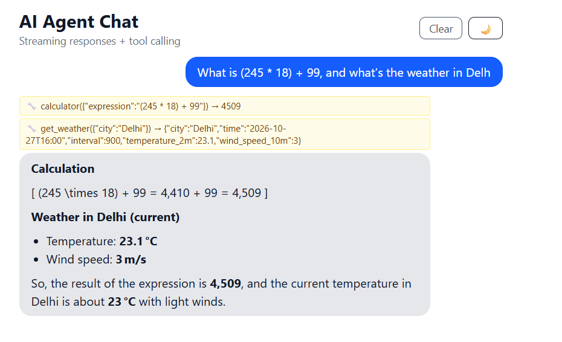
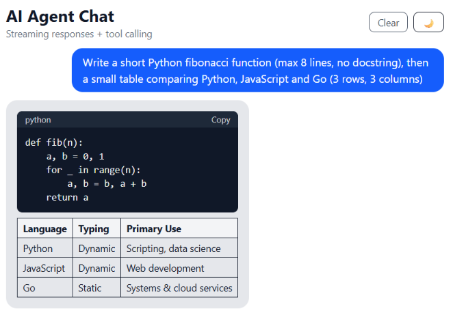
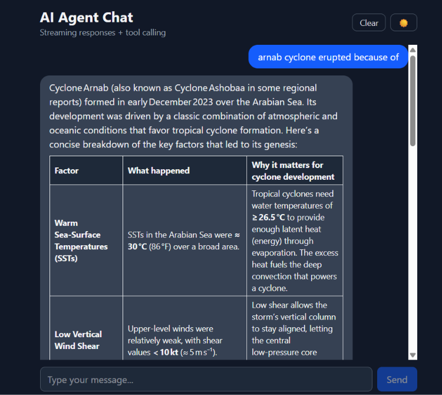

# AI Agent Chat

A ChatGPT-style AI chat app with **real-time streaming** and **tool calling**. The AI can decide to call tools (calculator, weather), and the UI shows each tool step live while the answer streams in word by word.

**Live demo:** _add your Vercel link here_
**Backend API:** _add your Render link here_

> The backend runs on a free Render instance, so the first message after a long idle period can take up to a minute while the server wakes up.

## Screenshots

### Tool calling (agent steps shown live)


### Markdown, code blocks and tables


### Dark mode


## Features

- **Live streaming responses** using Server-Sent Events (SSE), rendered token by token
- **AI agent with tool calling**: calculator and live weather (Open-Meteo), with a multi-step loop (max 5 steps)
- **Live tool steps in the UI** (running / result) shown above the answer
- **Stop generation** button that cancels both the browser request and the upstream AI request
- **Markdown rendering** with tables, lists, and code blocks with a copy button
- **Chat history** saved in localStorage and sent as context with every request
- **Dark mode** and a **mobile-responsive** layout
- **Basic API protection**: rate limiting, CORS restricted to the frontend origin, input validation

## Tech Stack

| Layer | Tech |
|---|---|
| Frontend | React, TypeScript, Vite, Tailwind CSS, react-markdown |
| Backend | Node.js, Express |
| AI | Groq API (OpenAI-compatible) with an open-weight model |
| Deployment | Vercel (frontend), Render (backend) |

## How It Works

1. The frontend sends the chat history to the backend.
2. The backend streams the model's response and forwards each token as an SSE event.
3. If the model asks for a tool, the backend runs it, sends the result back to the model, and continues (agent loop).
4. The frontend reads the stream with `fetch` and `ReadableStream`, and updates the last message as events arrive.

## Run Locally

**Prerequisites:** Node.js 18+ and a free [Groq API key](https://console.groq.com/keys).

```bash
# 1. Backend
cd server
npm install
cp .env.example .env     # then add your GROQ_API_KEY
node server.js           # runs on http://localhost:5000

# 2. Frontend (in a new terminal)
cd client
npm install
npm run dev              # runs on http://localhost:5173
```

### Environment variables

| Variable | Where | Description |
|---|---|---|
| `GROQ_API_KEY` | server | Your Groq API key |
| `FRONTEND_URL` | server | Allowed frontend origin for CORS (default `http://localhost:5173`) |
| `VITE_API_URL` | client | Backend URL (default `http://localhost:5000`) |

## Project Structure

```
ai-agent-chat/
├── client/                 # React + TypeScript frontend
│   └── src/
│       ├── components/     # MessageContent (markdown + code blocks)
│       ├── hooks/          # useChat (streaming + state), useTheme
│       └── App.tsx
└── server/                 # Express backend
    └── server.js           # SSE endpoint, agent loop, tools, rate limit
```

## What I Learned

- Parsing an SSE stream manually with `fetch` and handling partial chunks
- Building an agent loop where streamed tool-call fragments are assembled by index
- Cancelling streams end to end with `AbortController`
- Protecting a public AI endpoint with rate limits, CORS, and validation

## Future Improvements

- Multiple chats with a sidebar
- Syntax highlighting in code blocks
- Voice input and output (Web Speech API)
- More tools (web search, Wikipedia)